# Deliverable templates

Skeletons for the files the workflow writes. Copy the structure, delete guidance lines in
`<angle brackets>`, and keep every heading so later phases and later sessions can find things.
The examples are fictional; replace them with the real product.

## Contents

1. `docs/product-brief.md`
2. `docs/sitemap.md`
3. `docs/user-flows.md`
4. Screen inventory table (inside `docs/user-flows.md`, or its own `docs/screens.md`)

---

## 1. `docs/product-brief.md`

```markdown
# <Product name> - product brief

Status: draft | approved   Last updated: <date>

## Product
<One sentence: what it is, for whom, doing what.>
First job to be done: <the one thing it must do well before anything else.>

## Audience
- Primary user: <role, expertise, device, frequency of use, context of use>
- Secondary users: <only if they change a design decision>
- The one person to design for: <a concrete description in one line>

## Goal and metric
- Business outcome: <what changes for the business or the user>
- Success metric: <the number, its current value if known, its target and its date>

## Constraints
- Platforms and breakpoints: <web desktop and mobile, iOS, both>
- Stack: <framework, component library, or "undecided">
- Brand and design system: <rules and assets, or "none">
- Accessibility target: <for example WCAG 2.2 AA>
- Timeline and team: <dates, who builds>
- Content: <what real content exists and what must be written>

## Non-goals
- <Explicitly out of scope for this round.>

## Open questions
| # | Question | Blocks | Owner | Answer |
| --- | --- | --- | --- | --- |
| 1 | <question> | sitemap / flows / direction / none | <name> | <pending or answer> |

## Visual direction
<Filled in at the Phase 3 gate. Name of the chosen direction, one paragraph tying it to this
brief, then the tokens Phases 4 and 5 use.>

| Token | Value | Role |
| --- | --- | --- |
| Type - display | <family, weight> | headings |
| Type - text | <family, weight> | body, controls |
| Type scale | <for example 14 / 16 / 20 / 28 / 40> | sizes in px |
| Colour - surface | <hex> | page background |
| Colour - text | <hex> | body text (<ratio>:1 on surface) |
| Colour - accent | <hex> | primary action, links |
| Colour - negative | <hex> | errors |
| Spacing scale | <for example 4 / 8 / 12 / 16 / 24 / 32 / 48> | px |
| Radius | <px or "none"> | controls, containers |
| Motion | <durations and easing, or "none"> | state changes only |

## Decisions
| Date | Gate | Decision | Made by |
| --- | --- | --- | --- |
| <date> | After Phase 2 | Sitemap and flows approved <with these changes> | <user> |
| <date> | After Phase 3 | Direction "<name>" chosen <with these changes> | <user> |
```

---

## 2. `docs/sitemap.md`

The sitemap says what exists and where it lives. It is not a flow; do not draw journeys here.

```markdown
# Sitemap

## Page tree
<Nested list, at most three levels deep. Each line: label, route pattern, access.>

- Home - `/` - public
- Catalogue - `/catalogue` - public
  - Category - `/catalogue/:categorySlug` - public
    - Item - `/catalogue/:categorySlug/:itemId` - public
- Account - `/account` - signed-in
  - Orders - `/account/orders` - signed-in
    - Order detail - `/account/orders/:orderId` - signed-in, owner only
  - Settings - `/account/settings` - signed-in
- Admin - `/admin` - role: admin
- Sign in - `/sign-in` - public, redirects away when already signed in
- Not found - `*` - public

## Route table
| Route | Page | Parameters | Access | Parent | Notes |
| --- | --- | --- | --- | --- | --- |
| `/catalogue/:categorySlug` | Category | `categorySlug` (kebab-case string) | public | Catalogue | 404 page when the slug is unknown |

## Navigation model
- **Primary** (always visible): <items, in order, with the label the user sees>
- **Secondary** (within a section): <tabs, side menu or sub-nav, per section>
- **Utility** (account, help, language, search): <items and where they sit>
- **Contextual** (inline links, related content, breadcrumbs): <rules>
- **Mobile**: <how the model changes at small widths: bottom tabs, menu, drawer>
- **Reachability**: <pages reachable only from one place, and pages reachable from everywhere>

## Access rules
| Level | Who | Can reach | Redirect when denied |
| --- | --- | --- | --- |
| public | anyone | <pages> | n/a |
| signed-in | any account | <pages> | `/sign-in?next=<route>` |
| role: admin | admins | <pages> | 403 page |

## Out of the tree
<Pages deliberately left out (non-goals) and system pages: 404, 403, 500, maintenance.>
```

---

## 3. `docs/user-flows.md`

One Mermaid `flowchart` per primary journey, three to six journeys. Every flow shows the happy
path, the alternate paths, the errors, the empty states and the recovery back onto the happy
path. A flow with only a happy path is a draft.

````markdown
# User flows

## Flow index
| # | Journey | Who | Entry point | Success state | Screens |
| --- | --- | --- | --- | --- | --- |
| F1 | <name> | <persona> | <where it starts> | <what done looks like> | S1, S2, S3 |

## F1 - <Journey name>

Goal: <what the person is trying to do>. Entry: <route or trigger>. Done when: <observable end state>.



Alternate paths: <skip, back, branch, shortcut, resume later>.
Errors and recovery: <validation, network, permission denied, expired session - each with the

```mermaid
flowchart TD
    start([Entry: /search]) --> s1[S1 Search results]
    s1 -->|results found| s2[S2 Item detail]
    s1 -->|no results| e1[/Empty state: no results - suggest broader terms/]
    e1 -->|edit query| s1
    s1 -->|network error| er1[/Error: could not load - retry/]
    er1 -->|retry| s1
    s2 -->|add to basket| s3[S3 Basket]
    s2 -->|back| s1
    s3 -->|checkout| auth{Signed in?}
    auth -->|no| signin[S4 Sign in]
    signin -->|success| s3
    signin -->|invalid credentials| er2[/Error: wrong email or password/]
    er2 -->|try again| signin
    auth -->|yes| done([Success: order confirmation])
```

recovery step>.
Empty states: <nothing yet, no results, still loading - each with the next action offered>.
Accessibility notes: <focus management after navigation and after errors, announcements>.
Walked in prototype: [ ] not walked   (tick when walked; record date and size)

## F2 - <Journey name>
<Same structure.>

## Cross-cutting states
- Loading: <skeleton or spinner rules, minimum display time>
- Offline and slow network: <behaviour>
- Session expiry: <behaviour and where the person lands afterwards>
- Permission denied: <behaviour>
````

Mermaid conventions: `([ ])` for entry and success, `[ ]` for screens, `{ }` for decisions,
`[/ /]` for error and empty states, edge labels for the trigger. Give every screen the same ID
(`S1`, `S2`) it has in the inventory.

---

## 4. Screen inventory table

Every screen in a flow appears here, and every screen here appears in the sitemap. Put it at the
end of `docs/user-flows.md` under `## Screen inventory`, or in `docs/screens.md` for larger
products.

```markdown
## Screen inventory

| ID | Screen | Route | Purpose | Primary action | States | Responsive behaviour | Flow |
| --- | --- | --- | --- | --- | --- | --- | --- |
| S1 | Search results | `/search?q=` | Let the person scan matches and refine | Open an item | empty (no results), loading (skeleton rows), error (retry banner), success (list) | Desktop: filters in a left rail, 3-column results. Tablet: filters in a drawer, 2 columns. Mobile: filters in a full-screen sheet, 1 column, sticky search field | F1 |
| S2 | Item detail | `/catalogue/:categorySlug/:itemId` | Decide whether to buy | Add to basket | loading, not found, out of stock, success | Desktop: gallery left, details right. Mobile: gallery above details, sticky add-to-basket bar | F1 |
```

Column guidance:

- **States**: list the states that exist for this screen out of empty, loading, error, success,
  plus screen-specific ones (partial, offline, read-only, over limit). Each listed state needs a
  reachable control in the prototype.
- **Responsive behaviour**: say what changes at desktop (1440), tablet (768) and mobile (390):
  layout, navigation, which content collapses or moves, which controls change form. "Stacks" is
  not enough; say what stacks in what order.
- **Flow**: the flow ID that owns the screen; add others when shared.
